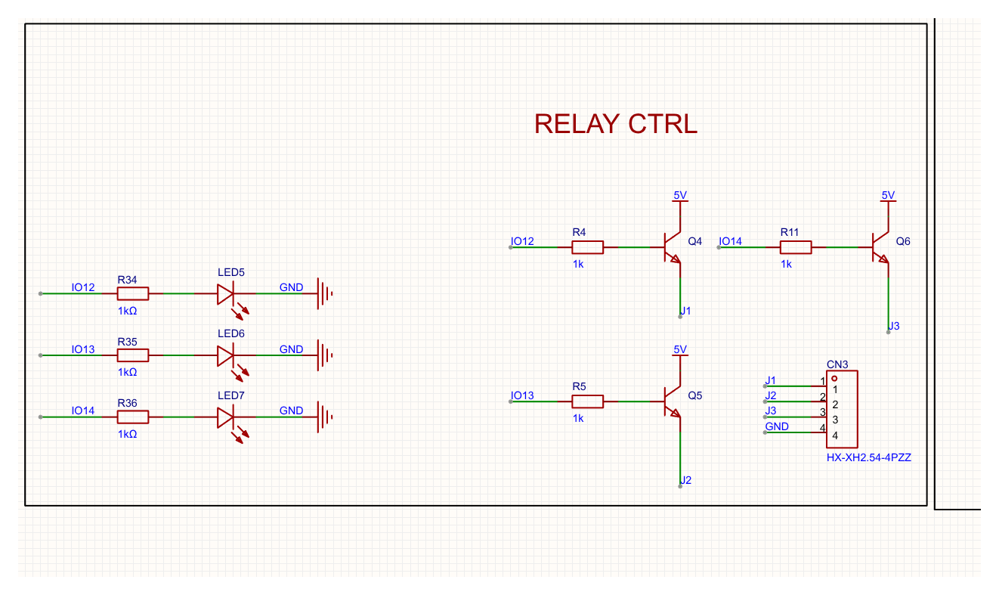

# 继电器驱动与状态指示灯（CH32V307 板 RELAY CTRL）



> 图由 EasyEDA Pro 的 `getCurrentRenderedAreaImage` 直接渲染，不是屏幕截图。

## 现状

三路一模一样，网表核对（`sch_ManufactureData.getNetlistFile`）：

| 网络 | 成员 | 说明 |
|---|---|---|
| `IO12/13/14` | R4 / R5 / R11 = 1k → 基极 | IO 只出基极电流 |
| `5V` | Q4/Q5/Q6 集电极 | 来自 USB VBUS（`USB1-B4A9/A4B9` → U3-3 VIN） |
| `J1/J2/J3` | 射极 + CN3 的 1/2/3 脚 + R34/R35/R36 | 输出节点 |
| `GND` | LED5/6/7 阴极、CN3-4 | |

Q4/Q5/Q6 是 S8050（SOT-23，1=B、2=E、3=C），**射极跟随器**（高边 NPN）：负载接在射极（J1）和 GND（CN3-4）之间。

`IO12/13/14` 是孤立单点网络，只挂了 R4/R5/R11 一端，没有连到 MCU。要落板得在 CORE 页接出来。

## 状态灯

灯挂在**输出侧**（射极节点），和负载并联：

```
            5V
             │
IO12 ─1k── B Q4  C ── 5V
             E ─┬─ J1 ── 外部继电器线圈 ── GND
                │
                R34 1k ── ▶| ── GND
```

- 灯电流走 `5V → 三极管 → 灯`，不从 IO 抽；IO 只出基极电流
- 灯亮 = 三极管真的导通 = 输出真的有电（比挂在 IO 上更贴近事实）
- 灯和线圈是并联的两条支路，灯那 ~2mA 不占线圈的电压

数值（5V 驱动、1k 基极、β≈100、5V/70mA 线圈 ≈ 70Ω）：

| 负载 | 射极电压 | 灯电流 |
|---|---|---|
| 只有灯 | ≈ 4.2V | ≈ 2.3mA |
| 带 70Ω 线圈 | ≈ 3.7V | ≈ 1.8mA |

射极跟随器天生丢一个 Vbe：5V 驱动下线圈只拿到约 3.7V，5V 继电器动作电压一般 3.75V，正好卡边；基极电阻换 330Ω 能到约 4.1V。

## 注意事项

- **续流二极管**：灯现在坐在输出节点上，线圈断电的反峰会把这个节点拉负，灯是反偏的，会被顶到 5~6V 反向（超过 LED 反向耐压）。外部继电器若不自带，建议在 Jx 与 GND 之间反并一只 1N4148（K 朝 Jx）。
- **省电阻和挂输出侧互斥**：灯在输出侧就必须自带限流电阻（和基极不是一个节点）。想省掉那颗电阻只有把灯串进基极支路，但那会直接从输出里扣掉一个 Vf（约 1.9V）。

## 元件清单

| 位号 | 器件 | 值 |
|---|---|---|
| R34 / R35 / R36 | 0603WAF1001T5E（C21190） | 1kΩ |
| LED5 / LED6 / LED7 | KT-0603R（C2286） | 0603 红灯 |
