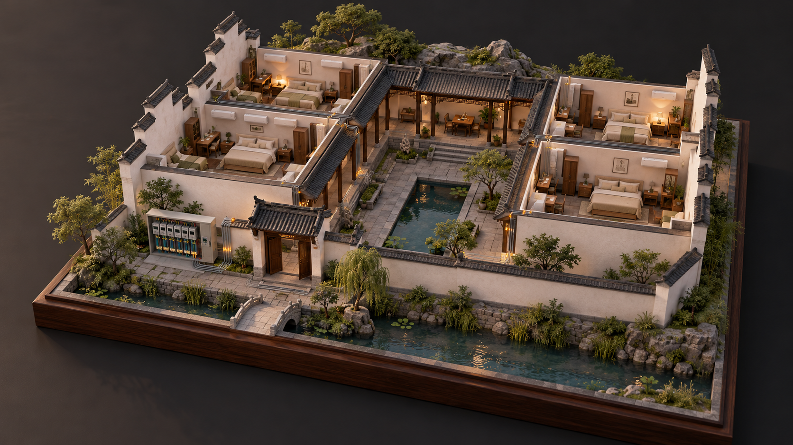

# 半写实沙盘后续升级规划

状态：基于当前源码与三轮运行截图整理的规划建议。用户已确认采用第三张「半写实探索版」的视觉方向；下列新增交互、素材和介绍页属于后续建议，尚未实施。

## 已选视觉概念图

用户选定的第三张「半写实探索版」，作为后续材质、配色、光照与场景氛围的参考。房间数量、布局和设备对应关系按项目实际数据实现。

此图为 AI 生成的视觉概念图；当前网页运行效果见各轮验收截图。原图随文档保存在 `半写实沙盘素材/视觉概念图-第三张-半写实探索版.png`。

## 目标与范围

围绕比赛电脑与大屏展示，把江南民宿沙盘做成既有场景质感、又能讲清实际用电的展示入口。延续半写实剖切表达、暖木灰瓦和琥珀色用电线路，保留客房内部可见性。

继续使用现有 Bun、Vue 与 Three.js。保留按 rooms 生成房间、现有数据源和管理页。每次只完成一个可运行、可截图验收的阶段，维持原型代码的精简。

本规划聚焦沙盘展示；人走断电、告警、语音、部署等业务与工程目标仍按各自规划处理。

## 当前基础

- 半写实材质、青瓦、叶簇、连续草坡、河岸、池景及客房软装已落地。
- 灯具、设备指示、功率光和线路流动使用现有数据映射，演示数据有标识。
- 已有旋转、缩放、全景及客房近景按钮；近景是预设机位，还不能点选任意房间。
- 已有总功率、累计电量、在线客房概览；房间逐项读数目前仍在管理详情页。
- 房间点选与读数面板、配电板专门讲解、自动运镜、介绍页尚未实现。
- 已有桌面和窄屏截图、构建检查及短时渲染采样。比赛设备、投影效果和完整讲解过程仍需现场验收；已有采样不能当作其他设备的性能保证。

## 建议执行顺序

| 阶段 | 优先级 | 主要成果 | 相对投入 | 完成标准 |
| --- | --- | --- | --- | --- |
| 整体美术定稿 | 高，建议下一步 | 确定全景、客房与配电板的构图和光线，整理景观留白与房名层次 | 小到中 | 三个视角重点明确，建筑和线路可辨，浮层不挡讲解对象 |
| 房间交互与读数 | 高 | 点选任意客房，聚焦并显示对应真实读数，支持返回全景和进入详情页 | 中 | 画面、房名、设备 ID 与详情页数据一致，鼠标和触摸均能完成操作 |
| 关键素材升级 | 中，先做局部样板 | 精修近景中的床、空调、树木或石材，按收益替换少量纹理或模型 | 中到较大，取决于素材 | 同机位对比确有改善，设备仍能随状态变化，整场景运行负担可接受 |
| 配电展示与讲解 | 中，比赛展示价值高 | 配电板近景、部件标注、所选房间对应线路强调 | 中 | 能连续讲清电能表、断路器、ESP32 与客房的对应关系 |
| 现场验收与收尾 | 高，贯穿各阶段并在交付前集中完成 | 在演示电脑与实际大屏检查、调整画质和文字，保留稳定演示入口 | 小到中 | 完整讲解可顺利走通，核心状态真实，场景和管理页切换正常 |

## 整体美术定稿

- 以第三张参考图的材质和氛围为依据，确定一套固定的傍晚光照。
- 调整建筑、空地、后山与水景的比例，让客房和配电板成为全景重点。
- 为全景、客房和配电板各确定一个主机位。近景避开马头墙和瓦檐遮挡；机位变化后仍保留回全景的入口。
- 整理房名、用电光点和浮层的层次：全景易定位，近景能读清；用电状态不被装饰性亮点淹没。
- 用单房、六房和多进合院检查构图，保留相同状态、相同机位的前后截图。

本阶段以现有场景完成整体收敛，不持续增加零散摆件。形成认可的全景与近景截图后，再进入下一阶段。

## 房间交互与读数

- 点击客房选择房间并高亮边界；桌面可补充轻量悬停提示，触摸操作不依赖悬停。
- 镜头聚焦所选房间。移动端采用紧凑读数面板或底部面板，留出观察空间。
- 展示房名、在线状态、功率、电量、电表读数及开关状态，复用详情页的数据与格式规则。
- 提供关闭面板、回全景和进入对应管理详情页的入口；先保持只读展示。
- 离线显示最后数据，未上报保留缺失含义，读数不齐给予提示；连接状态与设备在线状态分别表达。
- 演示角标与数据断流提示始终可见；断流后停止用电流动表现。

实现从现有详情页抽取必要展示内容即可，不引入新状态框架或另建一套接口。

## 关键素材升级

当前主要依靠程序化几何与本地生成纹理。进一步接近参考图的精细质感时，优先处理镜头会停留的局部。

- 先选一间客房与一棵树作为素材样板，比较程序化精修与精选素材替换的实际收益。
- 重点候选：床品的厚度与垂感、空调外形、木石纹理的尺度、树冠自然度、配电部件轮廓。
- 保留程序化房间布局，只替换局部外观。灯罩、指示灯等受数据驱动的部分应可单独修改材质。
- 同一场景统一比例、色调、细节程度和光照，不把不同风格素材直接混放。
- 模型与纹理保存在项目本地；选用来源、许可清楚的素材，贴图大小和模型复杂度按演示设备控制。
- 外部模型作为选配方案。现有旧设计中「全部程序化生成」的限制若需调整，应随选定方案一起明确；本规划不直接改写已确认的设计文件。

AI 参考图用于确定方向，不能直接视为可导入的三维模型。用户无需先准备整套 Blender 工程或完整建筑模型。

## 配电展示与讲解

- 根据实际硬件照片校准配电板、电能表、断路器和 ESP32 的主要外形与安装关系。
- 增加可读的部件名称标注，在近景中解释各自作用，全景保持简洁。
- 选择房间时强调其对应线路，其余线路降低存在感；光点仍由实际用电状态驱动。
- 演示路径建议为「整体民宿 → 一间客房 → 对应配电板与线路 → 管理详情」。手动切换优先，讲解者控制节奏。

配电板是展示模型。若涉及准确接线示意，应依据用户提供的实际接线关系单独整理，不以装饰走线代替电气接线图。

## 可选展示扩展

核心场景与交互定稿后，再按比赛需要选择：

- 平滑镜头过渡与可暂停巡游；任何手动输入立即接管，减少动态效果设置下保持静态可用。
- 全屏与常驻大屏布局，兼顾比赛电脑的屏幕比例。
- 介绍页：围绕现有真实能力组织开场、改造硬件、实时用电、人员感知和多端入口，先完成文字与讲解路径，再接镜头变化。
- 性能不足时的轻量画质、三维不可用时的平面展示。

日夜切换、动态天气、密集植被和大范围场景扩展保持低优先级，按明确展示收益选择。

## 用户需补充的信息

| 信息 | 用途 | 何时需要 |
| --- | --- | --- |
| 比赛电脑型号、显卡情况，大屏分辨率与电视或投影类型 | 确定画质、字重与验收环境 | 现场验收前，越早越好 |
| 大致房间数量、最想讲清的技术亮点 | 确定主构图与演示顺序 | 美术定稿前 |
| 整体配电板及各部件清晰照片 | 校准硬件外观与标注 | 配电展示阶段前 |
| 是否继续使用虚构合院；如需复现，提供民宿照片和简单平面草图 | 决定布局与建筑准确程度 | 改动建筑布局前 |
| 现场可用准备时间、是否接受付费素材 | 缩减阶段范围、选择素材路线 | 排实施日程前 |

未获得具体期限前，采用阶段顺序与相对投入安排，不承诺固定工期；素材采购另按用户明确范围执行。

## 验收与停止条件

- 每阶段通过构建、真实页面检查和必要的交互验证；素材或渲染变化时在同一设备、同一视口和机位采样，不用不同会话的数据直接证明性能改善。
- 正式验收使用比赛设备与实际大屏，以操作流畅、远距离读数清楚为准。可将持续约 30 FPS 作为初始目标，实际画质按测量调整。
- 重点走通房间选择、实时状态变化、数据断流提示、返回全景和进入管理页；连续完成一次完整讲解，确认没有累积卡顿和明显资源异常。
- 材质和模型可离线加载；连接中断时明确提示，真实与演示数据有清楚区别。无需为验收启动会写入大量数据的 simulator。
- 核心交付范围是「美术定稿＋房间交互＋配电讲解＋现场验收」。关键素材按视觉收益穿插实施，介绍页和巡游不阻塞核心交付。
- 当认可的全景、近景质量达标，数据能讲清且完整讲解顺畅时，结束纯装饰迭代。后续改动围绕具体问题逐项提出。
