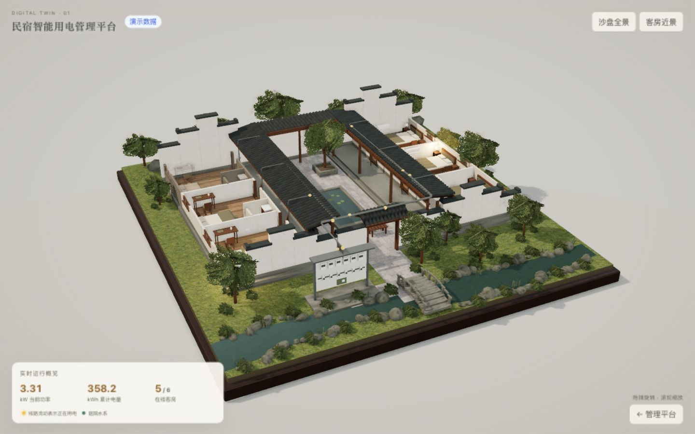
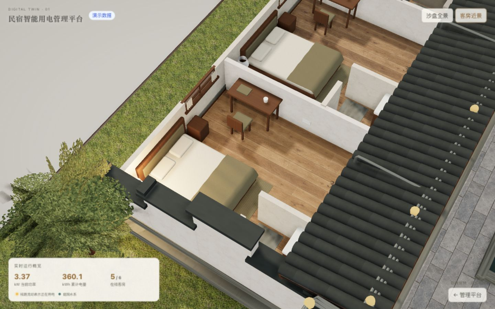

# 半写实沙盘材质与背景修改总结

## 当前效果

沙盘沿用已选「半写实探索版」概念图的江南民宿风格，使用浅暖灰展厅背景、暖白浮层、深色文字和木质底座。主光偏中性，客房台灯和琥珀线路仍由现有数据驱动。

白墙、客房木地板、庭院石板和建筑周边草地使用项目内的生成贴图。院门朝溪、石桥与庭院的构图属于已有基线；当前未提交改动集中在背景、地表与材质接入。

## 本地素材

四张 PNG 均通过内置 image_gen 工具按[概念图](半写实沙盘素材/视觉概念图-第三张-半写实探索版.png)的材质风格生成，尺寸均为 1254 × 1254，合计 14,681,886 字节，约 14 MiB。

| 文件 | 用途 | 铺贴尺度 |
| --- | --- | --- |
| [lime-plaster.png](../../../web2/src/assets/textures/lime-plaster.png) | 灰泥白墙、院墙与马头墙 | 约两米一幅，按墙面实际尺寸铺贴 |
| [oak-floor.png](../../../web2/src/assets/textures/oak-floor.png) | 客房木地板 | 约两米一幅，板条与端接缝错开 |
| [courtyard-stone.png](../../../web2/src/assets/textures/courtyard-stone.png) | 庭院、入口与配电板前石径 | 约 2.4 米一幅 |
| [garden-ground.png](../../../web2/src/assets/textures/garden-ground.png) | 建筑周边草地与后山 | 约两米一幅，低矮细草与苔土混合 |

[生成说明与完整提示词](../../../web2/src/assets/textures/生成说明.md)与图片同目录保存。页面通过源码内的相对导入引用 PNG，Vite 构建将四张原图输出到 `dist/assets/`，不依赖个人电脑上的生成缓存或在线素材地址。

## 实现入口

| 文件 | 当前职责 |
| --- | --- |
| `web2/src/twin/surfaces.ts` | 加载本地颜色贴图，配置重复、色彩空间和过滤；从同一原图派生凹凸、粗糙度贴图 |
| `web2/src/twin/materials.ts` | 组合生成图片材质与现有小件程序纹理；草地和后山采用同一材质风格 |
| `web2/src/twin/sandbox.ts` | 校准灰泥 UV 尺度与轻微墙脚旧化；庭院和石径使用石板材质；草地表面与土色侧面分开；释放材质时包含粗糙度贴图 |
| `web2/src/twin/scene.ts` | 设置浅暖灰背景、地面与中性主光；雾效距离随全景取景调整，窄屏退远时保持模型清晰 |
| `web2/src/pages/TwinPage.vue` | 暖白面板、深色文字与较深琥珀数字；保留取景、概览和管理入口 |

凹凸与粗糙度是颜色图派生的展示用近似，不是扫描测量的完整 PBR 材质。材质颜色变化、离线表现和线路流动继续复用已有房间数据映射；本轮没有后端接口、数据库或业务功能改动。

## 验证结果

- `bun run --cwd web2 build` 通过，包含 TypeScript 检查与 Vite 构建；产物清单包含四张 PNG。构建仍有 Three.js 分包大于 500 kB 的体积提示。
- `git diff --check` 通过。四张 PNG 和 `surfaces.ts` 可被 Git 识别为待添加文件，没有被忽略规则排除。
- 已在运行页面检查 1440 × 900 桌面与 390 × 844 窄屏，使用带「演示数据」角标的六房场景，核对全景、客房近景、贴图尺度和返回全景操作；控制台没有贴图加载或渲染警告、错误。
- 贴图生成后未重测单房与多进合院；比赛电脑、大屏投影、持续帧率和长时间资源占用仍需现场验证。没有为本轮验收启动会写入数据的 simulator。

## 运行截图

以下为运行页面截图，非生成概念图。





## 本地提交范围

当前提交应包含五个前端源码文件、`web2/src/assets/textures/` 下四张 PNG 与生成说明，以及本总结、两张运行截图和项目结构说明。素材原图与截图均位于仓库内；`web2/dist/` 是忽略的构建产物，无需入库。

建议提交标题：`feat: 优化孪生沙盘背景并接入生成材质贴图`。

可直接使用的提交说明：

```text
优化孪生沙盘的浅暖灰背景与浮层配色，改善模型与读数的可见性。

加入灰泥白墙、木地板、庭院石板和草地四张本地生成贴图，统一铺贴尺度并派生凹凸与粗糙度；草地侧面保留土层颜色，雾效随取景距离调整。

保存材质原图、生成提示词和运行截图。

验证：web2 构建通过；桌面与窄屏下六房演示场景的全景、近景和返回操作检查通过。
```
